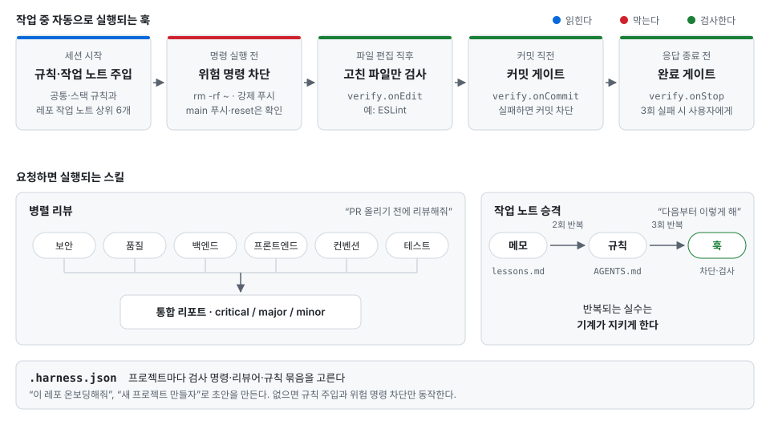

# my-dev-system

Claude Code가 프로젝트 규칙을 읽고, 코드를 편집하거나 커밋할 때 팀이 정한 검사를 실행하게 하는 개인 개발 하네스다. 하나의 플러그인을 여러 프로젝트에 설치하고, 각 프로젝트의 `.harness.json`에서 검사 명령과 리뷰 범위를 선택한다.

<picture>
  <source media="(prefers-color-scheme: dark)" srcset="docs/overview-dark.svg">
  
</picture>

## 설치

훅 실행에는 Node.js 18 이상과 Git이 필요하다. Claude Code에서 다음 두 명령을 차례로 실행한다.

```text
/plugin marketplace add jongsujin/my-dev-system
/plugin install harness@my-harness
```

설치 명령의 `harness`는 플러그인 이름이고 `my-harness`는 이 저장소가 등록하는 마켓플레이스 이름이다. 로컬 사본으로 개발할 때는 첫 번째 명령의 저장소 이름 자리에 로컬 경로를 넣는다.

### Codex에 설치하기

Codex CLI 0.171 기준으로 확인했다. 터미널에서 실행한다.

```bash
codex plugin marketplace add jongsujin/my-dev-system   # 로컬 사본이면 경로
codex plugin add harness@my-harness
codex plugin list                                     # harness@my-harness  installed, enabled
```

플러그인은 스킬 네 개와 훅 세 개(세션 시작, Bash 실행 전, 응답 완료 전)를 설치한다. Codex는 새 훅을 처음 실행하기 전에 신뢰 여부를 묻는다. 승인하면 `~/.codex/config.toml`의 `[hooks.state]`에 해시가 기록되고, 훅 내용이 바뀌면 다시 묻는다.

스킬마다 `skills/<이름>/agents/openai.yaml`에 Codex용 표시 이름·설명·기본 프롬프트·암묵 호출 정책을 둔다(`new-project`는 명시 호출만). Claude Code는 이 파일을 무시한다.

Codex 플러그인은 서브에이전트를 설치하지 않는다. 리뷰어를 Codex 역할로 쓰려면 저장소 사본에서 변환 스크립트를 실행한다.

```bash
node scripts/codex-agents.mjs            # 만들 파일과 config.toml 블록 미리보기
node scripts/codex-agents.mjs --apply    # ~/.codex/agents/harness-*.toml 생성, config.toml 에 [agents.*] 블록 추가
node scripts/codex-agents.mjs --remove   # 제거
```

`--apply`와 `--remove`는 `config.toml`을 고치기 전에 `config.toml.harness-backup`으로 백업한다. 다시 실행하면 표시된 블록만 교체한다. `CODEX_HOME`을 지정하면 그 경로에 설치한다.

Claude Code와 달라지는 점:

| 항목 | Codex 동작 |
| --- | --- |
| 확인 요청(`ask`) | Codex 훅은 확인 요청을 지원하지 않는다. 확인이 필요한 명령은 실행하지 않고, 사용자에게 직접 실행할지 묻도록 안내한다. |
| 파일 편집 직후 검사 | 실행되지 않는다. Codex의 편집 도구 입력 형식이 달라서다. 응답 완료 전 검사가 대신 확인한다. |
| 리뷰어 | `harness_reviewer_security` 같은 역할 이름으로 하위 에이전트를 만든다. |

## 프로젝트에 적용하기

설치 후 대상 프로젝트에서 **“이 레포 온보딩해줘”**라고 요청하면 `harness:onboard`가 실행·검사 명령을 조사하고 설정 초안을 제안한다. 직접 설정하려면 대상 프로젝트의 Git 루트에 `.harness.json`을 만든다. 다음은 `npm test`가 있는 프로젝트에서 시작할 수 있는 최소 예시다.

```json
{
  "verify": {
    "commands": { "test": "npm test" },
    "onStop": ["test"],
    "onCommit": ["test"]
  }
}
```

이 설정으로 Claude Code가 기본 검사 대상인 JS·TS·Vue 계열 파일을 변경한 뒤 응답을 끝내면 테스트가 실행된다. Claude Code의 Bash 도구로 커밋할 때도 테스트가 실행되며, 실패하면 커밋을 막는다. 프로젝트의 린트·타입 검사까지 연결하려면 실제 스크립트 이름에 맞춰 템플릿을 수정한다. 템플릿의 `context.rules`는 프론트엔드 예시다. 서버 코드가 있으면 `backend`를 더한다. [전체 설정 예시](templates/harness.json) · [설정 스키마](schemas/harness-config.schema.json)

## 훅이 실행되는 시점

| 시점 | 동작 |
| --- | --- |
| 세션 시작·재개 | 공통 규칙, `context.rules`로 선택한 스택 규칙, `.harness/lessons.md`의 교훈을 읽는다. 교훈은 반복 횟수순으로 기본 6개를 선택한다. |
| Bash 도구 실행 전 | 루트 전체 삭제나 강제 푸시 등 등록된 명령 패턴을 차단한다. 보호 브랜치를 명시한 직접 푸시나 `git reset --hard` 등은 확인을 요청한다. `guard.deny`와 `guard.ask`로 프로젝트 패턴을 추가할 수 있다. |
| 파일 편집 직후 | `verify.onEdit`가 있으면 설정된 확장자의 파일에 검사를 실행한다. 명령의 `{file}`에는 프로젝트 기준 상대 경로가 들어간다. |
| 응답 완료 전 | 이번 세션에서 바뀐 검사 대상 확장자 파일이 있으면 `verify.onStop`에 지정한 명령을 실행한다. 세션 시작 전부터 바뀌어 있던 파일은 세션 중 다시 고치지 않는 한 대상이 아니다. 같은 세션에서 세 차례 종료를 막은 뒤에도 실패하면 결과를 사용자에게 전달하고, 그 뒤 파일이나 실패 항목이 바뀌지 않으면 다시 막지 않는다. |
| Bash 도구로 커밋하기 전 | `verify.onCommit`에 지정한 명령을 순서대로 실행한다. 첫 실패의 명령과 출력을 보여 준다. |

완료·커밋 검증 명령은 하나당 `verify.timeoutSec`(기본 180초)까지 실행하고, 훅 전체로는 커밋 270초·완료 570초 안에서 끝낸다. 시간 안에 끝나지 않았거나 남은 시간이 없어 실행하지 못한 검사는 실패로 처리한다.

설정 파일이 없어도 공통 규칙과 기존 교훈을 읽고 기본 위험 명령을 검사한다. 설정 파일이 JSON으로 읽히지 않으면 검증 게이트를 모두 끄고, 세션 시작 때 파싱 오류를 알린다. `onStop`·`onCommit`에 `verify.commands`에 없는 이름을 적으면 세션 시작 때 경고한다. 완료·커밋 검사 실패를 안내만 하려면 `gates.block`을 `false`로 둔다. 편집 직후 검사는 `verify.onEdit`로 별도 설정한다. [훅 이벤트 정의](hooks/hooks.json) · [기본 명령 패턴](hooks/scripts/guard-rules.mjs)

## 스킬

| 요청 예시 | 결과 |
| --- | --- |
| “이 레포 온보딩해줘” | 기존 프로젝트에서 확인한 명령과 위험 영역을 바탕으로 온보딩 문서, `.harness.json`, `AGENTS.md` 초안을 제안한다. |
| “새 프로젝트 만들자” | 요구사항과 스택을 정한 뒤 린트·타입 검사·테스트·CI를 갖춘 골격과 첫 기능을 만든다. |
| “PR 올리기 전에 리뷰해줘” | 보안·품질·백엔드·프론트엔드·프로젝트 규칙·테스트 중 변경에 맞는 관점으로 리뷰한다. 결과는 `.harness/reviews/`에 저장한다. |
| “다음부터 이 방식으로 해줘. 기억해” | `.harness/lessons.md`에 교훈을 기록하고, 반복된 항목을 규칙이나 훅으로 옮길지 제안한다. |

리뷰 기준 브랜치의 기본값은 `main`이다. 프로젝트별로 `review.base`와 `review.reviewers`를 바꿀 수 있다. 각 리뷰어는 파일 위치, 근거, 영향과 수정 방향을 같은 형식으로 반환한다. [스킬 정의](skills/) · [에이전트 정의](agents/) · [리뷰 결과 스키마](schemas/review-envelope.schema.json)

## 테스트와 규칙 내보내기

하네스 저장소 루트에서 실행한다. 훅과 테스트는 Node.js 내장 모듈을 사용한다.

```bash
npm test
npm run build:agents-md -- typescript react
```

README 위쪽의 개요 그림은 `node scripts/build-overview-svg.mjs`가 `docs/`에 만든다. 훅이나 리뷰어가 바뀌면 스크립트의 목록을 고치고 다시 실행한다.

첫 명령은 위험 명령 판단, 교훈 선택, 설정 기본값과 검증 명령 해석을 검사한다. 두 번째 명령은 공통·TypeScript·React 규칙을 `dist/AGENTS.md` 한 파일로 합친다. 인자를 생략하면 공통 규칙만 담는다. 생성된 문서에서 필요한 지침을 Codex 등 다른 에이전트가 읽는 프로젝트의 `AGENTS.md`에 병합할 수 있다. [규칙 원본](rules/) · [내보내기 스크립트](scripts/build-agents-md.mjs)
